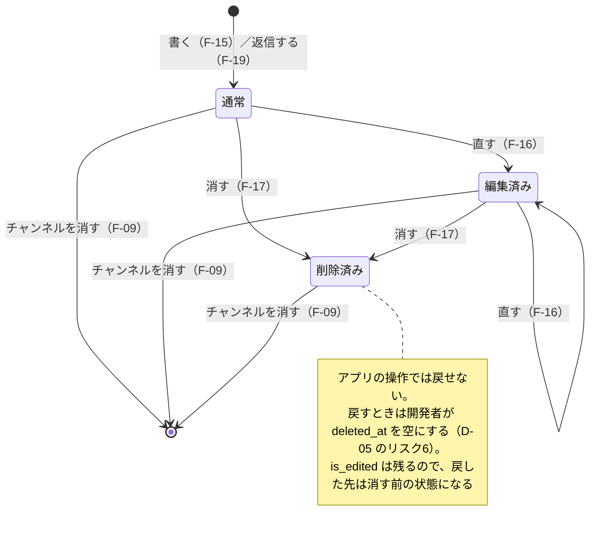
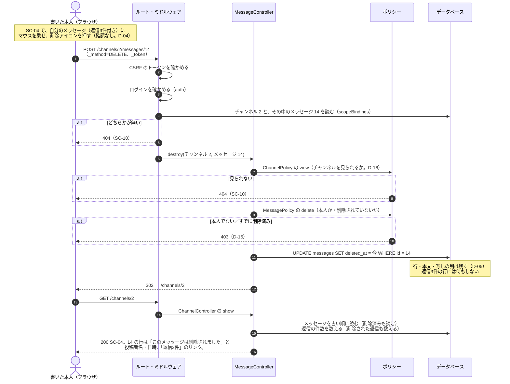

# 振る舞いの設計（状態遷移図・シーケンス図・例外方針）

仕様書（`docs/spec.md`）・モックアップ（`mockup/`）・ここまでの設計書（`features.md`・`questions.md`・`screens.md`・`data.md`・`permissions-api.md`）を根拠に、データの状態の移り方、代表的な処理の流れ、うまくいかなかったときの扱いを決めたものです。

- 機能は `features.md` の **F-xx**、確認事項と決定は `questions.md` の **Q-xx**／**R-xx**／**D-xx**、画面は `screens.md` の **SC-xx** で示します
- 根拠の資料に無く、ここで選んだものには **［設計］** を付けています。決まっていないものは「4. まだ決まっていないこと」に書いています

**クラス図は作らない。Laravel の MVC の標準の作り（ルート → コントローラ → モデル・ポリシー → Blade のビュー）に乗せる。**

---

## 1. 状態遷移図（メッセージ）

状態を持つのはメッセージ（返信を含む）だけです。返信もメッセージと同じ表に持ち（D-06）、同じように移ります（Q-15）。

### 1-1. 状態

状態は、`is_edited` と `deleted_at` の2つの列で決まります（`data.md` 2-4）。

| 状態 | `is_edited` | `deleted_at` | チャンネル・スレッドの表示 | 検索 | 公開API | 書いた本人ができること |
|:--|:--|:--|:--|:--|:--|:--|
| 通常 | 偽 | 空 | 本文 | 出す | 出す（返信は出さない） | 直す・消す |
| 編集済み | 真 | 空 | 本文と、末尾に「編集済み」 | 出す | 出す。`is_edited` が `true` | 直す・消す |
| 削除済み | どちらでも | 日時 | 本文の代わりに「このメッセージは削除されました」。投稿者名と日時は残す。**「編集済み」は出さない** | 出さない | 出さない | なし |

- 削除済みで「編集済み」を出さないのは、guide 4 で「編集済み」が**本文の末尾**に付くもので、削除済みは本文を出さないため（guide 4 の「削除されました」）
- どの状態でも、元のメッセージなら**誰でも返信できる**（削除済みでも。R-06）。返信が付いても、元のメッセージの状態は変わらない
- どの状態でも、元のメッセージには「返信N件」を出す。削除された返信も数える（Q-18、D-05）
- 行が消える（`[*]` に戻る）のは、チャンネルを消したときだけ。メッセージも返信も一緒に消える（R-02、`data.md` 2-4 の CASCADE）

### 1-2. 移り方

| 操作 | 前 → 後 | できる人 | データで変わること |
|:--|:--|:--|:--|
| 書く・返信する | — → 通常 | チャンネルを見られる人（`permissions-api.md` 1-3 の a） | 行を作る |
| 直す | 通常・編集済み → 編集済み | 書いた本人（同 b） | `body`・`body_normalized` を直し、`is_edited` を真にする（戻さない。R-05）。前後の空白・改行を取り除いた本文が今の本文と同じなら、何も変えない（D-25） |
| 消す | 通常・編集済み → 削除済み | 書いた本人（同 b）。確認は挟まない（D-04） | `deleted_at` に日時を入れる。本文・写しの列は残す（D-05） |
| チャンネルを消す | どれでも → 無し | チャンネルを作った人 | 行が消える |

- 削除済みからは、直す・消すのどちらもできない（D-05 のリスク4）。画面には操作を出さず、直接送られたときはサーバーで止める（`permissions-api.md` 1-5）
- 直すにも消すにも、期限は無い（R-05、Q-19）。直す前の本文の履歴は残さない（Q-19）

---

## 2. シーケンス図（代表: スレッドの返信が付いたメッセージを、書いた本人が削除する）

返信の付いたメッセージを消しても、返信は残り、「返信N件」も残る、という決まり（spec 3-4・3-5、Q-18、D-05）がいちばん多く関わる処理なので、これを代表にしました。

**前提**: 佐藤 太郎が、公開チャンネル「開発」（ID 2）を開いている。自分が書いたメッセージ（ID 14）に、返信が3件付いている。スレッドは開いていない。

- 移動したあとの SC-04 は、ブラウザが `#message-14` の行の位置まで移動して見せる（`permissions-api.md` 2-2）
- スレッドを開いていたとき（`?thread=` 付きの画面で消したとき）は、フォームが `thread` も送り、戻り先も `/channels/2?thread=…#message-14` になる
- 「返信3件」を押して SC-05 を開くと、元のメッセージは「このメッセージは削除されました」、返信3件はそのまま並び、返信欄も出る（F-18、R-06）
- 消したあとは、14 は検索にも（Q-20）、公開APIにも（R-11）出ない。公開APIの、ほかのメッセージの返信件数は変わらない

---

## 3. 例外方針

うまくいかなかったときに、利用者に何を見せるかです。権限が無いときの細かい返し方は `permissions-api.md` 1-5、公開APIのエラーの形は同 3-4 にあります。

### 3-1. 起きることごとの扱い

| # | 起きること | 画面（web） | 公開API | 根拠 |
|:--|:--|:--|:--|:--|
| 1 | 入力エラー（空・長すぎる・重複・確認の入力が一致しない など） | 送った画面（編集中・確認を開いた状態を含む）に戻し、欄の下にエラーを1つ出す。入力した値は残す（パスワードを除く）。検索だけは SC-09 にエラーを出す | 入力が無いので起きない。壊れた `cursor` は最初から返す | D-02 / screens.md 4章 / permissions-api.md 2-2 |
| 2 | ログインしていない | SC-01 へ移す | 認証が無いので起きない | F-04 |
| 3 | 見つからない・見る権利が無い（存在しないチャンネル、メンバーでないプライベートチャンネル、公開チャンネルのメンバー管理、ほかのチャンネルのメッセージのID） | **404**（SC-10）。どの理由でも同じ表示 | **404**。どの理由でも同じ本文 | R-01 / Q-06 / Q-27 |
| 4 | 見られるが、その操作の権限が無い（作成者でない・本人でない・削除済み・作成者を外す） | **403**（Laravel の標準の画面。英語のまま。D-14） | — | D-15 / D-05 のリスク4 |
| 5 | 操作のあいだに、相手が変わった（開いていたチャンネルが消された、メンバーから外された、メッセージが消された） | **送ったときの状態**で判断する。3 か 4 と同じ扱いになる | 3 と同じ | ［設計］ |
| 6 | ログインの有効期限が切れたあとに、**ページを開いた**（いまの設定では、操作しないまま120分たつと切れる。`.env.example` の `SESSION_LIFETIME`） | SC-01（ログイン）へ送り直す（`auth`。#2 と同じ）。ログインしたあとは、開こうとしていたページへ戻す（Q-04） | 認証が無いので起きない | F-04 / Q-04 |
| 7 | **フォームを送った**ときに、CSRF のトークンが合わない（画面を開いたままログインが切れた、別のタブでログアウト・ログインをしてトークンが変わった、など） | **送信そのものを弾く**。何も保存しない。Laravel の標準の 419 の画面（英語のまま。D-14）。入力した値は残らない。ページを開き直すと、ログインが切れていれば #6 のとおり SC-01 へ移る | CSRF を見ないので起きない | ［設計］ |
| 8 | 想定外の失敗（データベースにつながらない など） | Laravel の標準の 500 の画面。中身の詳しいことは画面に出さず、ログ（`storage/logs`）に残す | `{"message": "Server Error"}` の 500 | ［設計］ |
| 9 | 同じフォームを2回続けて送った（ボタンの二度押し） | **受け入れる**（JavaScript を使わないのでボタンを止められない。D-03）。メッセージが2件になったら、本人が消す | — | D-03 |
| 10 | ほぼ同時の送信で、重複のチェックをすり抜けた | **受け入れる**（利用者20人ほど）。メンバーの二重追加は主キーで止まり 500 になる。チャンネル名は表で止めていない（Q-32）ので、同じ名前ができることがある | — | spec 1 / data.md 2-2・2-3 |

- ログインが切れたまま**フォームを送ると、#6 ではなく #7 になる**。CSRF のトークンはログイン状態と同じセッションに入っていて、Laravel は CSRF の確認をログインの確認より先に行う（`app/Http/Kernel.php` の `web` グループの順）ため

### 3-2. 全体の決まり

| 決まり | 内容 | 根拠 |
|:--|:--|:--|
| 本番では詳しいエラーを出さない | `APP_DEBUG` を `false` にする。`true` のままだと、404 の画面にモデルの名前やIDが出て、3-1 の #3 の「どの理由でも同じ」が崩れる | R-01 / Q-27 |
| エラーの画面は Laravel の標準のまま | 404・403・419・500 は、Laravel の標準の画面を使い、**英語の表示のまま**にする（日本語の画面は用意しない） | D-14 |
| 404 の画面は理由で変えない | 存在しない・見る権利が無い、を同じ表示にする。理由をログに残すのはよいが、画面には出さない | R-01 |
| 2つの表を書く処理はまとめる | チャンネルの作成（channels と、プライベートなら channel_user の作成者の行）は、1つのトランザクションにする。途中で失敗したら両方とも書かない | data.md 2-2 |
| チャンネルの削除は1回で | channels の行を消せば、メッセージ・返信・メンバーの行は CASCADE で一緒に消える。途中で止まった状態は残らない | data.md 2-3・2-4 |
| メッセージの削除は戻せる形にする | 行も本文も消さず、`deleted_at` を入れるだけ。誤って消したときは、開発者が `deleted_at` を空にして戻す | D-05 のリスク6 |
| 入力の確かめはサーバーで | 画面の入力欄で止めない。すべて送ったあとにサーバーで確かめる | D-02 / D-03 |

---

## 4. まだ決まっていないこと

いまは無い。以前ここにあった3件は、次のとおり決めた（`questions.md`）。

| # | 項目 | 決めたところ |
|:--|:--|:--|
| 1 | 権限の無い操作の返し方 | D-15（403） |
| 2 | 外された人の、自分のメッセージの編集・削除 | D-16（できない） |
| 3 | 削除の期限・編集の履歴 | Q-19（期限なし・履歴は残さない） |
