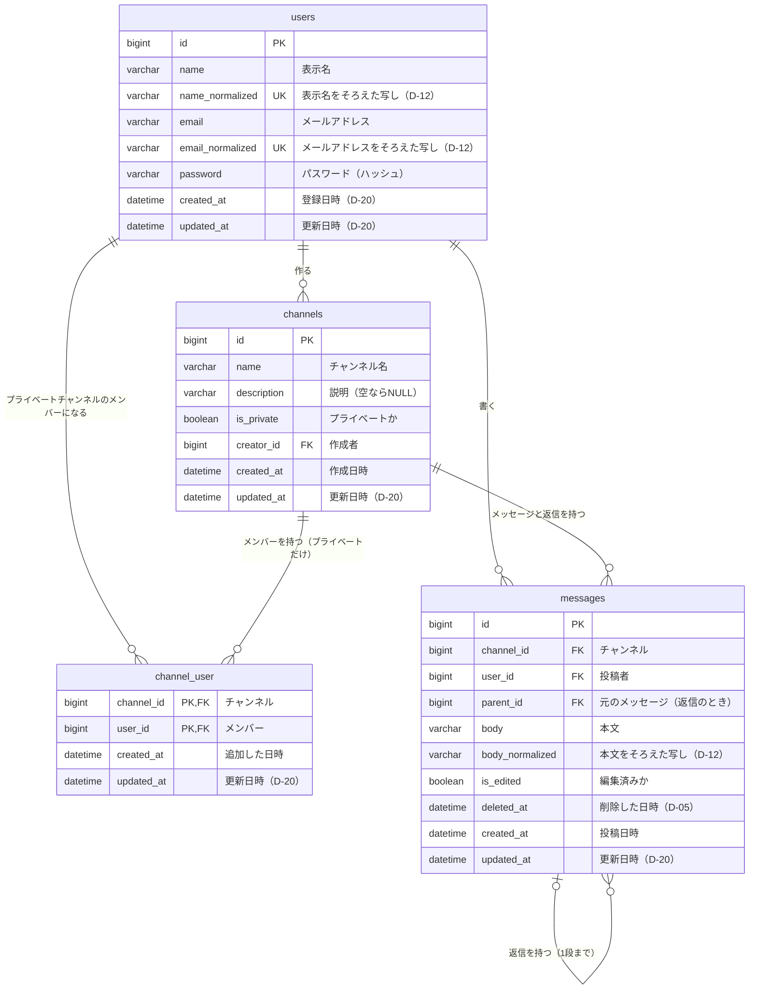

# データ設計（ER図・テーブル定義書・CRUD表）

仕様書（`docs/spec.md`）・モックアップ（`mockup/`）・ここまでの設計書（`features.md`・`questions.md`・`screens.md`）を根拠に、データの形を決めたものです。

- 機能は `features.md` の **F-xx**、確認事項と決定は `questions.md` の **Q-xx**／**R-xx**／**D-xx**、画面は `screens.md` の **SC-xx** で示します
- 根拠の資料に無く、データの形を決めるためにここで選んだものには **［設計］** を付けています
- **埋まらなかったところは、埋めずに「5. まだ決まっていないこと」に書いています**
- DBは MySQL（`.env.example`）です

---

## 0. この設計の前提（D-01・D-05〜D-13・D-16・D-17・D-20〜D-22・D-24・D-25・D-27 の決定）

データの形に効く決定です。理由は `questions.md` の「8.」にあります。

| ID | 決めたこと | データへの影響 |
|:--|:--|:--|
| D-01 | ログインは Laravel 標準の `Auth`（セッション）で自分で書く。**ログイン状態はファイルに保存する** | ログイン状態の表は持たない |
| D-05 | 削除したメッセージは、行を残し、削除の日時を持ち、本文も残す。SoftDeletes は使わない。経路ごとの扱い（取り出す・数に入れる・除く）は D-05 の補足のとおり | messages に `deleted_at`。削除は行の更新で、行は消えない |
| D-06 | 返信は**メッセージと同じ表（messages）**に持ち、`parent_id` で元のメッセージを指す | `parent_id` が NULL なら、チャンネルに直接書かれたメッセージ。返信の段数と同じチャンネルであることは、アプリで守る |
| D-07 | メンバーの表には、**プライベートチャンネルだけ**持つ。作成者も1行として持つ | 公開チャンネルの行は channel_user に入らない |
| D-08 | 削除の印の列名は `deleted_at` | SoftDeletes と見間違えないよう、定義に注記する |
| D-09 | 「編集済み」は真偽の列（`is_edited`）で持つ。編集した日時は持たない | `updated_at` は印に使わない |
| D-10 | Laravel が最初から用意している、**根拠の無いテーブル・列は載せない**（`password_reset_tokens`、`personal_access_tokens`、`failed_jobs`、users の `email_verified_at`・`remember_token`） | migration から消すかどうかは、実装のときに決める。作成日時・更新日時の列は例外（D-20） |
| D-11 | D-01（ログインの仕組み）が未決のまま書いた。**D-01 はそのあと決まった** | ログイン状態はファイルに保存するので、表は増えない。CRUD表の F-02〜F-04 も埋めた |
| D-12 | 検索・重複チェック・メンバー追加の一致は、英字の大小と全角・半角を区別せず、ひらがなとカタカナ・濁点は区別する。そろえた写しの列で比べる | messages に `body_normalized`、users に `name_normalized`・`email_normalized` を足す。UNIQUE は写しの列に付ける |
| D-13 | メールアドレスは254文字まで | users の `email`・`email_normalized` を varchar(254) にする |
| D-16 | メンバーから外された人は、自分のメッセージも直せない・消せない | CRUD表の F-16・F-17 で、channels・channel_user を読む |
| D-17 | チャンネル一覧・サイドバー・公開APIの並びは、作成日時の古い順 | channels の `created_at` を並びに使う |
| D-20 | 作成日時・更新日時の列は、Laravel の慣習どおり持つ（D-10 の例外） | users に `created_at`・`updated_at`、ほかの3つの表に `updated_at` を足す |
| D-21 | 写しの列の手順1の「全角の記号」は、U+FF01〜FF5E の範囲だけ | 2章の写しの列のそろえ方 |
| D-22 | メールアドレスの形式チェックは、そろえる前の入力に当てる | users の `email` の説明 |
| D-24 | 表示名に「@」を使えない。メンバー追加は「@」の有無で比べる列を分ける | users の `name` の説明、CRUD表の F-12 |
| D-25 | 本文を変えずに保存しても「編集済み」にしない | messages の `is_edited` の説明 |
| D-27 | 初期データのうちモックに無い中身は、実装のときに作る。チャンネルの作成日時は D-17 の並びになる順にする | 4章 |

---

## 1. ER図

---

## 2. テーブル定義書

共通の決まり:
- 日時は、日本時間で保存する（Q-31）。型は `datetime`［設計］
- 主キーの `id` は、自動で振られる整数［設計］
- `created_at`・`updated_at` は、Laravel（Eloquent）が作るときと直すときに自動で入れる（D-20）。migration の `timestamps()` は型が `timestamp` で NULL 可になるので、使わずにこの表のとおり列を書く
- 文字コードは `utf8mb4`。文字の比べ方は D-12 のとおり。比べるのは写しの列（`_normalized`）だけで、写しの列の照合順序は `utf8mb4_bin`
- 写しの列のそろえ方:
  1. 全角の英数字・記号を半角にする（U+FF01〜FF5E の範囲だけ。`「」。、・ー〜` などは変えない。D-21）
  2. 全角の空白を半角にする
  3. 半角カナを全角カナにする（濁点・半濁点は、前の文字とまとめて1文字にする。長音や句読点などの半角の記号も全角にする）
  4. 英字を小文字にする

  ひらがなとカタカナ、濁点の有無は変えない。前後の空白と改行は、そろえる前に取り除く（D-02）
- 検索のキーワードも同じようにそろえてから、空白で区切る（全角の空白も区切りになる）

### 2-1. users（アカウント）

| 列 | 型 | NULL | 既定値 | キー | 説明 | 根拠 |
|:--|:--|:--|:--|:--|:--|:--|
| id | bigint unsigned | 不可 | 自動 | PK | | ［設計］ |
| name | varchar(30) | 不可 | | | 表示名。30文字まで。「@」（全角の「＠」を含む）は使えない（D-24）。画面に出すのはこの列。重複は name_normalized で止める | spec 3-1, 5-1 / Q-02 |
| name_normalized | varchar(30) | 不可 | | UNIQUE | 表示名をそろえた写し。重複チェックとメンバー追加の一致に使う。画面には出さない | Q-02 / Q-11 / D-12 |
| email | varchar(254) | 不可 | | | メールアドレス。254文字まで。形式のチェックは、そろえる前の入力に当てる（D-22）。画面に出すのはこの列。重複は email_normalized で止める | spec 3-1 / Q-02 / D-13 |
| email_normalized | varchar(254) | 不可 | | UNIQUE | メールアドレスをそろえた写し。重複チェック・メンバー追加の一致・ログインの照合に使う。画面には出さない | Q-02 / Q-11 / F-02 / D-12 / D-13 |
| password | varchar(255) | 不可 | | | パスワードを**ハッシュにして**保存する。8文字以上（入力のチェック） | spec 3-1（「よく使われているやり方」）, 5-1 |
| created_at | datetime | 不可 | | | 登録日時。使う機能は無い | D-20 |
| updated_at | datetime | 不可 | | | 更新日時。使う機能は無い | D-20 |

- 削除の操作は無い（Q-33）。そのため、ほかの表から users への外部キーは、削除時に止める（RESTRICT）にする

### 2-2. channels（チャンネル）

| 列 | 型 | NULL | 既定値 | キー | 説明 | 根拠 |
|:--|:--|:--|:--|:--|:--|:--|
| id | bigint unsigned | 不可 | 自動 | PK | 公開APIでも、チャンネルの指定に使う | spec 3-7 / Q-24 |
| name | varchar(50) | 不可 | | | チャンネル名。50文字まで。**表としての UNIQUE は付けない** | spec 3-2, 5-1 / Q-32 |
| description | varchar(200) | 可 | NULL | | 説明。200文字まで。必須ではない。空のときは NULL［設計］ | spec 3-2, 5-1 / screens.md 4-2 |
| is_private | boolean | 不可 | | | プライベートなら真。**作ったあとは変えない** | spec 3-2 / F-08 / mock channel-edit。持ち方（真偽）は［設計］ |
| creator_id | bigint unsigned | 不可 | | FK → users.id（RESTRICT） | 作った人。編集・削除・メンバー管理ができる人 | spec 3-2, 3-3 / F-06, F-08 |
| created_at | datetime | 不可 | | | 作成日時。公開APIで返す。チャンネル一覧・サイドバー・公開APIの並びに使う（古い順。同じ日時ならIDの小さい順） | Q-24 / D-17 |
| updated_at | datetime | 不可 | | | 更新日時。使う機能は無い | D-20 |

アプリで守る決まり（表の制約では守れないもの）:
- チャンネル名の重複は、**その人が見られるチャンネルの中だけ**で確かめる（Q-32）。見えないプライベートチャンネルと同じ名前は作れるので、UNIQUE にはできない
- 名前の重複は、見られるチャンネルの名前と入力した名前を、両方とも D-12 のそろえ方でそろえてから比べる（写しの列は持たない。UNIQUE を付けないので、表で守る必要がないため）
- プライベートチャンネルを作ったときは、同時に channel_user に作成者の行を作る（F-07、D-07）

### 2-3. channel_user（プライベートチャンネルのメンバー）

| 列 | 型 | NULL | 既定値 | キー | 説明 | 根拠 |
|:--|:--|:--|:--|:--|:--|:--|
| channel_id | bigint unsigned | 不可 | | PK, FK → channels.id（CASCADE） | チャンネル。チャンネルを削除したら、行も消える | spec 3-3 / R-02 / F-09 |
| user_id | bigint unsigned | 不可 | | PK, FK → users.id（RESTRICT） | メンバー | spec 3-3 |
| created_at | datetime | 不可 | | | 追加した日時。メンバー一覧を「作成者を先頭、そのあとは追加した順」に並べるのに使う | screens.md SC-08 No 7 |
| updated_at | datetime | 不可 | | | 更新日時。使う機能は無い | D-20 |

- 表の名前は、Laravel が中間テーブルとして既定で探す名前（2つのテーブル名を単数形にして、アルファベット順につなぐ）に合わせた
- 主キーを（channel_id, user_id）にして、同じ人を2回追加できないようにする（F-12「すでにメンバーである」）
- メンバーを外したら、行を消す。外したことの記録は持たない（F-13。外された人は見られなくなるだけで、記録を出す画面は無い）

アプリで守る決まり:
- **プライベートチャンネルにだけ**行を作る（D-07）
- 作成者の行は消さない（R-04、F-13）

### 2-4. messages（メッセージと返信）

| 列 | 型 | NULL | 既定値 | キー | 説明 | 根拠 |
|:--|:--|:--|:--|:--|:--|:--|
| id | bigint unsigned | 不可 | 自動 | PK | 公開APIでも返す | Q-24 |
| channel_id | bigint unsigned | 不可 | | FK → channels.id（CASCADE） | 書かれたチャンネル。**返信にも入れる**（元のメッセージと同じチャンネル）。チャンネルを削除したら、行も消える | spec 3-4 / R-02 / F-09。返信にも入れるのは、検索で見られるチャンネルを絞るため（spec 3-6） |
| user_id | bigint unsigned | 不可 | | FK → users.id（RESTRICT） | 書いた人。編集・削除ができるのはこの人だけ | spec 3-4 |
| parent_id | bigint unsigned | 可 | NULL | FK → messages.id（CASCADE） | 返信のとき、元のメッセージ。NULL ならチャンネルに直接書かれたメッセージ | spec 3-5 / D-06。CASCADE は、チャンネルを削除したときに、返信と元のメッセージを一緒に消せるようにするため［設計］ |
| body | varchar(1000) | 不可 | | | 本文。1,000文字まで。前後の空白と改行は取り除いて保存する。**削除しても消さず、「このメッセージは削除されました」も入れない** | spec 3-4, 5-1 / D-02 / D-05 |
| body_normalized | varchar(1000) | 不可 | | | 本文をそろえた写し。**検索だけに使い、画面・公開APIには出さない**。本文を直したら一緒に直す。削除しても消さない（D-05）。検索結果のキーワードの強調は、本文の側で当たった場所を探し直す（半角カナの濁点をまとめるため、写しと本文とで文字の位置がずれることがある） | F-21 / F-22 / D-12 |
| is_edited | boolean | 不可 | 偽 | | 一度でも直したら真。戻さない。本文が変わらない保存では変えない（D-25） | spec 3-4 / R-05 / D-09 |
| deleted_at | datetime | 可 | NULL | | 削除した日時。NULL なら削除されていない。**SoftDeletes は使わない** | D-05 |
| created_at | datetime | 不可 | | | 投稿日時。画面・検索結果・公開APIで出す | spec 3-4, 3-6 / Q-24 |
| updated_at | datetime | 不可 | | | 更新日時。使う機能は無い。削除のときにも変わるので、「編集済み」の印には使わない（D-09） | D-20 |

- **返信件数は列で持たず、そのつど数える**［設計］。削除された返信も数える（Q-18、D-05）
- 削除は `deleted_at` に日時を入れるだけ（行は消えない）。行が消えるのは、チャンネルを削除したときだけ（F-09）

アプリで守る決まり:
- 返信の元は、`parent_id` が NULL のメッセージだけ（返信は1段まで。R-08）
- 返信の `channel_id` は、元のメッセージと同じにする
- 削除済みのメッセージには返信できる（R-06）。編集・削除はできない（D-05 のリスク4）
- 検索と公開APIでは、`deleted_at` が入った行を除く。画面では取り出して、本文の代わりに文言を出す（D-05 の補足）

---

## 3. CRUD表

- **C** 作る／**R** 読む／**U** 直す／**D** 消す。空欄はその表を使わない
- メッセージの削除は、D-05 により行を消さないので **U**（`deleted_at` を入れる）。行が消える **D** は、チャンネルの削除だけ
- 「見られるか」の確認（F-10）は、プライベートチャンネルのときに channel_user を読む。表では、チャンネルの中を扱う機能すべてに **R** を付けている

| 機能 | users | channels | channel_user | messages | 補足 |
|:--|:--|:--|:--|:--|:--|
| F-01 新規登録 | C R | | | | R は表示名・メールアドレスの重複チェック（Q-02） |
| F-02 ログイン | R | | | | users の R は、入力したメールアドレスをそろえて、`email_normalized` で探す（D-12）。ログイン状態はファイルに保存するので、表は使わない（D-01） |
| F-03 ログアウト | | | | | 表は使わない（ログイン状態はファイル。D-01） |
| F-04 ログイン必須の制御 | | | | | 表は使わない（ログイン状態はファイル。D-01） |
| F-05 共通レイアウト | R | R | R | | users はログイン中の氏名。サイドバーは公開すべてと、自分がメンバーのプライベート |
| F-06 チャンネル一覧 | R | R | R | | users は作成者の表示名 |
| F-07 チャンネル作成 | | C R | C R | | channel_user の C は、プライベートのときの作成者の行。R は重複チェック（見られるチャンネルの中だけ。Q-32） |
| F-08 チャンネル編集 | | R U | R | | R は作成者の確認と重複チェック |
| F-09 チャンネル削除 | | R D | D | R D | messages の R は確認に出す件数（削除済みを含む。Q-28）。channel_user・messages の D は CASCADE |
| F-10 閲覧・書き込みの権限 | | R | R | | |
| F-11 メンバー一覧 | R | R | R | | users は表示名・メールアドレス |
| F-12 メンバー追加 | R | R | C R | | users の R は完全一致の検索（Q-11。比べ方は D-12。入力に「@」があれば `email_normalized`、無ければ `name_normalized` だけで探す。D-24）。channel_user の R は「すでにメンバー」の確認 |
| F-13 メンバー削除 | | R | D | | channels の R は作成者の確認（作成者は外せない） |
| F-14 メッセージ一覧 | R | R | R | R | 削除済みも取り出す（D-05）。返信件数も数える |
| F-15 メッセージ投稿 | | R | R | C | |
| F-16 メッセージ編集 | | R | R | R U | channels・channel_user の R は、チャンネルを見られるかの確認（D-16）。messages の R は、書いた本人か・削除済みでないかの確認。U は本文と写しの列を一緒に直す |
| F-17 メッセージ削除 | | R | R | R U | F-16 と同じ。U は `deleted_at` を入れる |
| F-18 スレッド表示 | R | R | R | R | 元のメッセージが削除済みでも開ける |
| F-19 返信投稿 | | R | R | C R | messages の R は、元のメッセージが返信でないことの確認（R-08） |
| F-20 返信件数の表示 | | | | R | 削除された返信も数える（Q-18、D-05） |
| F-21 メッセージ検索 | | R | R | R | 削除済みは除く。見られるチャンネルのものだけ（spec 3-6） |
| F-22 検索結果の表示 | R | R | | R | チャンネル名・投稿者・日時・本文 |
| F-23 公開チャンネル一覧API | R | R | | | users は作成者の表示名だけ（メールアドレスは返さない。Q-24） |
| F-24 チャンネル別メッセージ一覧API | R | R | | R | 削除済みの行は除く。返信件数は削除された返信も数える（D-05） |
| F-25 入力チェックとエラー表示 | R | R | R | | 重複チェックで読む（F-01・F-07・F-08・F-12 と同じ） |
| F-26 初期データ | C | C | C | C | |

---

## 4. 初期データとの対応

F-26 の初期データは、この表の形で入る。

- 「採用プロジェクト」（プライベート）だけ、channel_user に佐藤 太郎（作成者）と鈴木 花子の2行が入る。公開の3チャンネルには行が入らない（D-07）
- 「このメッセージは削除されました」の1件は、本文を持ったまま `deleted_at` が入った行になる（D-05）。この本文に「リリース」を含めない（F-26。検索の見本を3件のままにするため）
- モックに無い中身（本文・書いた人・日時）は、F-26 の条件を守って実装のときに作る。channels の `created_at` は、全体連絡→開発→雑談→採用プロジェクトの順になるように入れる（D-27、D-17）

---

## 5. まだ決まっていないこと

いまは無い。以前ここにあった4件は、次のとおり決めた（`questions.md` の8章）。

| # | 項目 | 決めたところ |
|:--|:--|:--|
| 1 | 作成日時・更新日時の列（根拠が無いもの） | D-20（持つ） |
| 2 | チャンネル一覧・サイドバーの並び順 | D-17（作成日時の古い順） |
| 3 | メンバーから外された人が、自分のメッセージを直す・消すこと | D-16（できない） |
| 4 | ログインの仕組み（D-01） | D-01（自分で書く。ログイン状態はファイル） |
