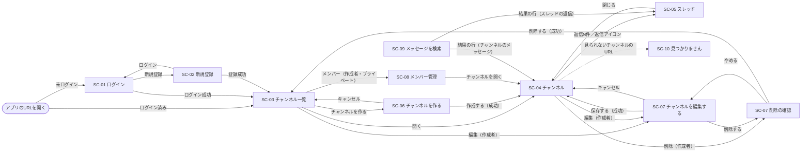
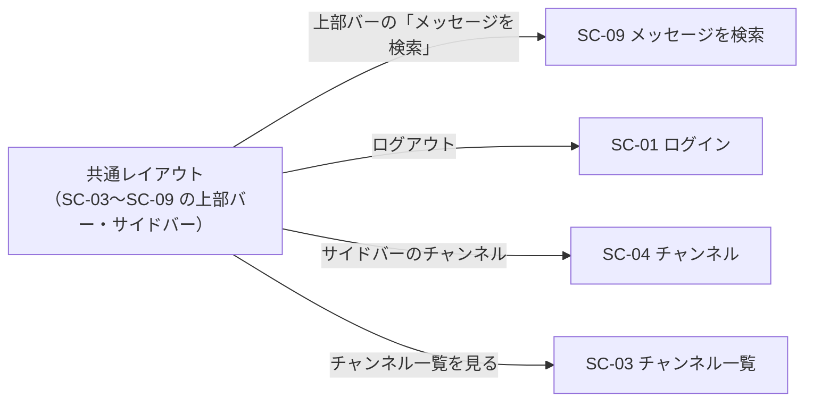
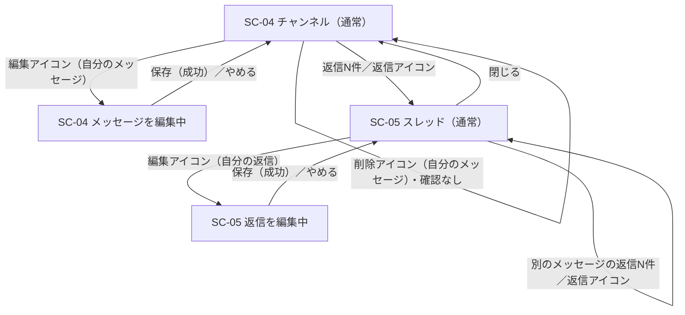

# 画面設計（画面一覧・画面遷移図・画面項目定義・入力チェックとメッセージ）

モックアップ（`mockup/`）を根拠に、画面を設計したものです。ワイヤーフレームは描いていません（モックアップがその役を果たすため）。

- 画面は **SC-01** から連番です。機能は `features.md` の **F-xx**、確認事項は `questions.md` の **Q-xx**／**R-xx**／**D-xx** で示します
- 「根拠」の `spec` は仕様書の章、`mock` はモックアップのファイル名、`guide` は `mockup/design-guide.md` の章です
- **モックアップに無く、ここで決めたもの**には **［設計］** を付けています。あとでモックアップと突き合わせるときの目印です

## 0. この設計の前提（D-02〜D-04 の決定）

画面の作りに効く決定です。中身と理由は `questions.md` の「8.」にあります。

| ID | 決めたこと | 画面への影響 |
|:--|:--|:--|
| D-03 | **JavaScript を使わない** | 画面の状態（スレッドを開いている、メッセージを編集中、削除の確認を開いている）は、**すべてURLで区別**し、ページの移動で切り替える。文字数は入力に追随させず、`1,000文字まで` の**目安表示**にする（guide 4 の「追随させないなら」） |
| D-02 | 上限を超えても**入力はできる**。**送信したときにサーバー側でチェック**し、欄の下にエラーを出す。前後の空白と改行を取り除いてから空かどうかを見る（空白や改行だけなら空） | エラーはすべて送信後に出る。入力した値はエラーのあとも残す（パスワード欄を除く） |
| D-04 | **メッセージ（返信を含む）の削除は確認を挟まない**。チャンネルの削除は確認を挟む（R-02） | メッセージの削除アイコンを押すと、すぐに削除される。チャンネル削除の確認は、モックの `channel-edit` のとおり |

---

## 1. 画面一覧

`mockup/index.html`（画面カタログ）は見本の入口で、アプリの画面ではないので載せていません。

| ID | 画面名 | 概要 | 使える人 | モック | 機能 |
|:--|:--|:--|:--|:--|:--|
| SC-01 | ログイン | メールアドレスとパスワードでログインする | 未ログインの人 | login | F-02 |
| SC-02 | 新規登録 | 表示名・メールアドレス・パスワードで登録する | 未ログインの人 | register | F-01 |
| SC-03 | チャンネル一覧 | 見られるチャンネルを一覧で見る。ログイン後・登録後の最初の画面（Q-04） | ログイン中の社員 | channels | F-06 |
| SC-04 | チャンネル | メッセージを読む・書く・直す・消す。状態として「メッセージを編集中」がある | チャンネルを見られる人 | channel-show | F-14〜17, F-20 |
| SC-05 | スレッド | SC-04 の右側にスレッドのパネルを開いた状態。返信を読む・書く・直す・消す。状態として「返信を編集中」がある | チャンネルを見られる人 | thread | F-18, F-19 |
| SC-06 | チャンネルを作る | 名前・説明・公開範囲を入れてチャンネルを作る | ログイン中の社員 | channel-new | F-07 |
| SC-07 | チャンネルを編集する | 名前・説明を直す。状態として「削除の確認」がある | チャンネルを作った人 | channel-edit | F-08, F-09 |
| SC-08 | メンバー管理 | プライベートチャンネルのメンバーを見る・追加する・外す | プライベートチャンネルを作った人 | members | F-11〜13 |
| SC-09 | メッセージを検索 | キーワードでメッセージを探し、結果を見る | ログイン中の社員 | search | F-21, F-22 |
| SC-10 | 見つかりません | 存在しないチャンネル、**見る権利のないプライベートチャンネル**のURLを開いたときに出す。両者を**同じ表示**にして、プライベートチャンネルがあることを分からないようにする（Q-06、R-01） | 全員 | なし［設計］ | F-10 |

- SC-03〜SC-09 は、共通レイアウト（F-05）の上部バーとサイドバーの中に表示する。SC-01・SC-02 は共通レイアウトを使わない（mock login, register）
- SC-10 は、モックが無いので **Laravel 標準のエラーページ（404）** をそのまま使う［設計］。画面項目定義は書かない
- 作成者以外が SC-07・SC-08 のURLを開いたときの扱いは、権限の設計（`permissions-api.md`）で決める

---

## 2. 画面遷移図

### 2-1. 画面どうしの遷移

入力エラーのときは、同じ画面にエラーを出して戻る（図では省略）。

**共通レイアウト（SC-03〜SC-09）から行ける先**は、図が読めなくなるので別に書きます。

| 遷移 | 根拠 |
|:--|:--|
| 登録後・ログイン後は SC-03。未ログインで画面のURLを開いたら SC-01 | Q-04 |
| 作成後は作ったチャンネルの SC-04、編集の保存後はそのチャンネルの SC-04、削除後は SC-03 | Q-08 |
| SC-04 の「削除」は、SC-07 の**削除の確認を開いた状態**へ移る | mock channel-show（「削除」のリンク先が channel-edit）。確認を開いた状態へ直接移すのは［設計］ |
| 検索結果の行は、そのメッセージがある SC-04 を開き、その位置まで移動する。返信なら SC-05 を開く | Q-22 |
| ログアウトは SC-01 へ | mock 各画面（「ログアウト」のリンク先が login） |
| キャンセルの戻り先（SC-06 → SC-03、SC-07 → SC-04） | mock channel-new, channel-edit |

### 2-2. SC-04・SC-05 の中の状態

JavaScript を使わない（D-03）ので、画面の中の状態もページの移動で切り替えます。どの状態もURLで区別します（具体的なURLは `permissions-api.md` のルーティング一覧で決める）。

- 送信・保存・削除のあとは、そのメッセージ（または返信）の位置まで移動した状態で表示する［設計］。ページの移動で画面の先頭に戻ってしまうと、どこを操作したのか分からなくなるため
- SC-05 を開いている間も、左側の SC-04 の操作（送信・編集・削除）はできる。操作のあとも SC-05 を開いたままにする［設計］

---

## 3. 画面項目定義

### 3-1. どこまで書くか

| 画面 | 書くか | 理由 |
|:--|:--|:--|
| SC-04 チャンネル | **書く** | アプリの中心。項目が最も多く、「本人にだけ出す」「削除済み」「編集済み」「編集中」など、見る人とデータで表示が変わる項目が集まっている |
| SC-05 スレッド | **差分だけ書く** | メッセージの行は SC-04 と同じ。違うのは、返信に「返信」の操作が無いこと（R-08）と、モックに無い編集・削除を置くこと（Q-15）だけ |
| SC-06 チャンネルを作る | **書く** | フォーム画面の代表。入力欄・補足・文字数・初期値の型をここで決め、ほかのフォームは入力チェック（4章）で足りるようにする |
| SC-07 チャンネルを編集する | **差分だけ書く** | 入力欄は SC-06 と同じ。違うのは公開範囲が無いことと、削除の確認（取り消せない操作）だけ |
| SC-08 メンバー管理 | **書く** | 「作成者は外せません」の押せない表示（guide 4）と、メンバー追加の決まり（Q-11）がある |
| SC-09 メッセージを検索 | **書く** | 見せてよい範囲が仕様書で特に強く求められている（spec 3-6）。結果の行のリンク・ページ送りは、モックに無く、ここで決めた（Q-21、Q-22） |
| SC-01 ログイン／SC-02 新規登録 | 書かない | 項目は入力欄とボタンだけで、入力欄の決まりは4章の入力チェックで尽きる。項目定義を書くと4章の繰り返しになる |
| SC-03 チャンネル一覧 | 書かない | 表示するだけの一覧で、行の中身はモックのとおり。誰の行に「編集」「メンバー」を出すかは F-06 にあり、権限マトリクス（`permissions-api.md`）でも扱う |
| SC-10 見つかりません | 書かない | モックが無く、Laravel 標準のエラーページを使うため |

### 3-2. 列の意味

- **種類**: 表示（文字を出すだけ）／リンク（別の画面・状態へ移る）／ボタン（送信する）／入力（テキスト・複数行・ラジオ）
- **出す条件**: 空欄は「いつも出す」
- **内容・初期値**: 「」の中はモックの文言のまま。［設計］はモックに無い

### 3-3. SC-04 チャンネル

モック: `channel-show.html`

**チャンネルの見出し**

| No | 項目 | 種類 | 出す条件 | 内容・初期値 | 根拠 |
|:--|:--|:--|:--|:--|:--|
| 1 | チャンネル名 | 表示 | | 公開は `#`、プライベートは鍵の記号を前に付ける | mock channel-show, channels |
| 2 | 公開範囲の印 | 表示 | | 「公開」または「プライベート」のバッジ | mock channel-show, channels |
| 3 | 説明 | 表示 | 説明があるとき | チャンネルの説明 | mock channel-show |
| 4 | 編集 | リンク | **チャンネルを作った人にだけ** | 「編集」→ SC-07 | mock channel-show / F-08 |
| 5 | 削除 | リンク | **チャンネルを作った人にだけ** | 「削除」→ SC-07 の削除の確認 | mock channel-show / F-09 |

**メッセージ一覧**（全件を古い順。F-14）

| No | 項目 | 種類 | 出す条件 | 内容・初期値 | 根拠 |
|:--|:--|:--|:--|:--|:--|
| 6 | 日付の区切り | 表示 | 日付が変わるところ | 「2026年8月17日（月）」の形。日本時間 | mock channel-show / Q-31 |
| 7 | アバター | 表示 | | 表示名の先頭2文字（例: 佐藤 太郎 →「佐藤」）。地色は guide 1 の4色から、人ごとに固定［設計: 割り当て方は利用者のIDで決める］ | mock channel-show / guide 1 |
| 8 | 投稿者名 | 表示 | | 表示名 | mock channel-show |
| 9 | 日時 | 表示 | | `2026/08/17 14:32` の形。日本時間 | guide 2 / Q-31 |
| 10 | 本文 | 表示 | 削除されていないとき | 書いたまま表示する。改行は残し、装飾・自動リンクはしない | Q-13 |
| 11 | 編集済みの印 | 表示 | 直したことがあるとき | 本文の末尾に「編集済み」 | mock channel-show / guide 4 / R-05 |
| 12 | 削除の表示 | 表示 | 削除されたとき | 本文の代わりに「このメッセージは削除されました」。投稿者名と日時は残す | mock channel-show / guide 4 |
| 13 | 返信件数 | リンク | 返信が1件以上あるとき（削除されたメッセージでも出す） | 「返信N件」→ SC-05。削除された返信も数える | mock channel-show / guide 4 / Q-18 |
| 14 | 操作: 返信 | リンク | 行にマウスを乗せたとき。削除されたメッセージにも出す | 返信アイコン → SC-05 | mock channel-show / guide 4 / R-06 |
| 15 | 操作: 編集 | リンク | 行にマウスを乗せたとき。**自分のメッセージで、削除されていないとき** | 編集アイコン → メッセージを編集中 | mock channel-show / guide 4 |
| 16 | 操作: 削除 | ボタン | 15 と同じ | 削除アイコン。押すと**確認なしで**削除する（D-04） | mock channel-show / guide 4 / D-04 |

- 14〜16 の「マウスを乗せたときに出す」は、CSS の `:hover` で行う（JavaScript は使わない。D-03）
- メッセージが0件のとき（作ったばかりのチャンネルなど）は、guide 4 の「空・0件」の形で「まだメッセージはありません」、その下に「下の欄から最初のメッセージを送ってください」を出す［設計: モックに0件の見本が無い。文言はここで決めた］

**メッセージを編集中**（その行だけが変わる。ほかの行はそのまま。guide 4）

| No | 項目 | 種類 | 出す条件 | 内容・初期値 | 根拠 |
|:--|:--|:--|:--|:--|:--|
| 17 | 編集欄 | 入力（複数行） | 編集中の行 | 初期値はいまの本文。下に「1,000文字まで」 | guide 4 / D-03 |
| 18 | 保存 | ボタン | 編集中の行 | 塗りのボタン「保存」。成功したら通常の状態へ | guide 4 |
| 19 | やめる | リンク | 編集中の行 | 「やめる」。直さずに通常の状態へ | guide 4 |

**投稿欄**

| No | 項目 | 種類 | 出す条件 | 内容・初期値 | 根拠 |
|:--|:--|:--|:--|:--|:--|
| 20 | 本文の入力欄 | 入力（複数行） | | プレースホルダ「#開発 にメッセージを送る」（`開発` はそのチャンネル名）。プライベートチャンネルも同じ形にする［設計: モックにプライベートの見本が無い］ | mock channel-show |
| 21 | 文字数の目安 | 表示 | | 「1,000文字まで」（モックの「0 / 1,000 文字」は、入力に追随させる場合の表示。D-03 で追随させないと決めたので、guide 4 の目安表示に置き換える） | mock channel-show / guide 4 / D-03 |
| 22 | 送信 | ボタン | | 「送信」 | mock channel-show |

### 3-4. SC-05 スレッド（SC-04 との差分）

モック: `thread.html`。左側は SC-04 のまま。右側にパネルを開く。

| No | 項目 | 種類 | 出す条件 | 内容・初期値 | 根拠 |
|:--|:--|:--|:--|:--|:--|
| 1 | パネルの見出し | 表示 | | 「スレッド」と、その下にチャンネル名（記号付き） | mock thread |
| 2 | 閉じる | リンク | | ×アイコン → SC-04（パネルを閉じた状態） | mock thread |
| 3 | 元のメッセージ | 表示 | | SC-04 の No 7〜12 と同じ。返信件数のリンク（No 13）とマウスを乗せたときの操作（No 14〜16）は出さない | mock thread |
| 4 | 返信件数 | 表示 | | 「返信N件」。0件のときも「返信0件」と出す［設計］ | mock thread |
| 5 | 返信の行 | 表示 | | SC-04 の No 7〜12 と同じ（古い順） | mock thread / F-18 |
| 6 | 返信の操作: 編集・削除 | リンク・ボタン | 行にマウスを乗せたとき。**自分の返信で、削除されていないとき** | SC-04 の No 15・16 と同じ。編集中の形も SC-04 の No 17〜19 と同じ。**「返信」の操作は出さない**（返信は1段まで） | Q-15 / R-08。モックには無い［設計: 置き方は SC-04 に合わせた］ |
| 7 | 返信の入力欄 | 入力（複数行） | | プレースホルダ「返信を送る」。下に「1,000文字まで」 | mock thread / D-03 |
| 8 | 送信 | ボタン | | 「送信」 | mock thread |

### 3-5. SC-06 チャンネルを作る

モック: `channel-new.html`

| No | 項目 | 種類 | 必須 | 内容・初期値 | 根拠 |
|:--|:--|:--|:--|:--|:--|
| 1 | 画面タイトル | 表示 | | 「チャンネルを作る」 | mock channel-new |
| 2 | チャンネル名 | 入力（1行） | ○（`*`） | 初期値は空。下の右に「50文字まで」 | mock channel-new / spec 5-1 / D-03 |
| 3 | 説明 | 入力（複数行） | | 初期値は空。下の左に補足「何について話す場所かを短く書きます。」、右に「200文字まで」 | mock channel-new / spec 5-1 / D-03 |
| 4 | 公開範囲 | 入力（ラジオ） | ○ | 「公開」（説明「ログインしている社員なら誰でも読み書きできます。」）と「プライベート」（説明「追加された人だけが読み書きできます。作成者がメンバーを管理します。」）。**初期値は「公開」** | mock channel-new |
| 5 | キャンセル | リンク | | 「キャンセル」→ SC-03 | mock channel-new |
| 6 | 作成する | ボタン | | 塗りのボタン「作成する」。成功したら作ったチャンネルの SC-04 へ | mock channel-new / Q-08 |

- 公開範囲の欄にはモックで `*` が付いていないが、どちらかが必ず選ばれている（初期値が「公開」）ので、必須として扱う
- エラーのときは、入力した値を残したまま、欄の下にエラーを出す（D-02）

### 3-6. SC-07 チャンネルを編集する（SC-06 との差分）

モック: `channel-edit.html`

**編集のカード**

| No | 項目 | 種類 | 内容・初期値 | 根拠 |
|:--|:--|:--|:--|:--|
| 1 | 画面タイトル | 表示 | 「チャンネルを編集する」 | mock channel-edit |
| 2 | チャンネル名 | 入力（1行） | 初期値はいまの名前。下の左に補足「公開チャンネルです。公開範囲はあとから変更できません。」（プライベートチャンネルのときは「プライベートチャンネルです。公開範囲はあとから変更できません。」［設計: モックは公開の見本だけ］） | mock channel-edit / F-08 |
| 3 | 説明 | 入力（複数行） | 初期値はいまの説明。補足は出さない（モックは空） | mock channel-edit |
| — | 公開範囲 | — | **出さない**（あとから変更できない） | mock channel-edit |
| 4 | キャンセル | リンク | 「キャンセル」→ SC-04 | mock channel-edit |
| 5 | 保存する | ボタン | 塗りのボタン「保存する」。成功したら SC-04 へ | mock channel-edit / Q-08 |

**チャンネルを削除する**（見出し「チャンネルを削除する」）

| No | 項目 | 種類 | 出す条件 | 内容・初期値 | 根拠 |
|:--|:--|:--|:--|:--|:--|
| 6 | 削除の案内 | 表示 | | 「このチャンネルを削除します」「メッセージと返信もすべて削除され、元に戻せません。」 | mock channel-edit |
| 7 | 削除する | リンク | | 枠の赤いボタン「削除する」→ 削除の確認を開いた状態 | mock channel-edit / D-03 |
| 8 | 確認の問い | 表示 | 確認を開いた状態 | 「「開発」を削除しますか？」（`開発` はそのチャンネル名） | mock channel-edit |
| 9 | 影響の範囲 | 表示 | 確認を開いた状態 | 「メッセージ N件と返信 M件も削除されます。この操作は取り消せません。確認のためチャンネル名を入力してください。」N・M は**そのときの実際の件数（削除済みを含む）** | mock channel-edit / Q-28 |
| 10 | 確認の入力欄 | 入力（1行） | 確認を開いた状態 | 初期値は空。プレースホルダはそのチャンネル名 | mock channel-edit |
| 11 | やめる | リンク | 確認を開いた状態 | 「やめる」→ 確認を閉じた状態 | mock channel-edit |
| 12 | 削除する（確定） | ボタン | 確認を開いた状態 | 塗りの赤いボタン「削除する」。No 10 がチャンネル名と一致したときだけ削除し、SC-03 へ。一致しないときは SC-07 の確認を開いた状態に戻してエラーを出す | mock channel-edit / guide 4 / Q-08 |

- No 12 の一致チェックは、送信後にサーバー側で行う（D-03 で、入力に応じてボタンを押せるようにする作りは採らない）

### 3-7. SC-08 メンバー管理

モック: `members.html`。プライベートチャンネルを作った人だけが開ける（F-11）。

| No | 項目 | 種類 | 出す条件 | 内容・初期値 | 根拠 |
|:--|:--|:--|:--|:--|:--|
| 1 | チャンネル名 | 表示 | | 鍵の記号＋名前＋「プライベート」のバッジ | mock members |
| 2 | 説明と案内 | 表示 | | 「採用まわりの進行　·　追加された人だけが読み書きできます。」（前半はそのチャンネルの説明。説明が空のときは案内だけ） | mock members |
| 3 | チャンネルを開く | リンク | | 「チャンネルを開く」→ SC-04 | mock members |
| 4 | 追加の入力欄 | 入力（1行） | | 見出し「メンバーを追加する」。初期値は空。プレースホルダ「表示名またはメールアドレスで探す」 | mock members |
| 5 | 追加 | ボタン | | 塗りのボタン「追加」。入力に**完全に一致する人を1人**追加し、SC-08 に戻る | mock members / Q-11 |
| 6 | メンバーの人数 | 表示 | | 「メンバー　N人」 | mock members |
| 7 | メンバーの行 | 表示 | | アバター・表示名・メールアドレス。作成者には「作成者」のバッジ。並びは作成者を先頭、そのあとは追加した順［設計: モックは作成者が先頭］ | mock members |
| 8 | 外す | ボタン | 作成者以外の行 | 枠の赤いボタン「外す」。押すと確認なしで外し、SC-08 に戻る（モックに確認が無い） | mock members / F-13 |
| 9 | 外す（押せない） | 表示 | 作成者の行 | 押せない「外す」と、横に「作成者は外せません」 | mock members / guide 4 / R-04 |

### 3-8. SC-09 メッセージを検索

モック: `search.html`。ログインした人だけが使える（R-09）。上部バーの「メッセージを検索」から入る。

| No | 項目 | 種類 | 出す条件 | 内容・初期値 | 根拠 |
|:--|:--|:--|:--|:--|:--|
| 1 | 画面タイトル | 表示 | | 「メッセージを検索」 | mock search |
| 2 | キーワード | 入力（1行） | | 初期値は直前に探したキーワード（無ければ空） | mock search |
| 3 | 検索 | ボタン | | 塗りのボタン「検索」 | mock search |
| 4 | 件数 | 表示 | 探したとき | 「「リリース」の検索結果　3件」（`リリース` は入れたキーワード、件数は全ページの合計） | mock search |
| 5 | 結果の行: チャンネル | 表示 | 1件以上 | `#` または鍵＋チャンネル名 | mock search |
| 6 | 結果の行: 投稿者・日時 | 表示 | 1件以上 | 「鈴木 花子 · 2026/08/17 09:12」の形 | mock search |
| 7 | 結果の行: 本文 | 表示 | 1件以上 | **本文の全文**を、SC-04 の No 10 と同じ形（改行を残す）で出す。キーワードに一致した部分を強調（guide 1 の `mark`）。複数のキーワードは、それぞれを強調する。モックの1件目は最初の1文だけだが、全文を出すことにした［設計］ | mock search / guide 1 / Q-20 |
| 8 | 結果の行のリンク | リンク | 1件以上 | 行を押すと、そのメッセージがある SC-04 を開き、その位置まで移動する。返信なら SC-05 も開く | Q-22［設計: モックに押せる形が無い］ |
| 9 | ページ送り | リンク | 21件以上 | 「前のページ」「次のページ」。1ページ20件、新しい順 | Q-21［設計: モックに無い］ |
| 10 | 0件の表示 | 表示 | 0件 | guide 4 の「空・0件」の形。「「議事録」に一致するメッセージはありません」、その下に「別のキーワードで試すか、キーワードを短くしてください。」 | mock search / guide 4 |

- 上部バーの「メッセージを検索」は、キーワードの入力欄にする。入れて送ると SC-09 に結果を出す［設計: モックは入力欄の見た目だけで、押したときの動きが無い］
- キーワードを入れずにURLで SC-09 を開いたときは、No 1〜3 だけを出す（結果の欄は出さない）
- **結果に出すのは、その人が見られるチャンネルのメッセージだけ**（spec 3-6、F-21）。削除されたメッセージは出さない（Q-20）

---

## 4. 入力チェックとエラーメッセージ

### 4-1. 共通の決まり

| 決まり | 内容 | 根拠 |
|:--|:--|:--|
| いつチェックするか | 送信したとき、サーバー側で行う。上限を超えて入力すること自体は止めない | D-02 |
| どこに出すか | その欄の下に、12px の赤文字で、文頭に赤い丸の `!` を付ける。欄の枠と地も赤にする | guide 4 |
| 文の形 | **1文・句点なし**。「〜してください」「〜ません」の形 | guide 4（例「チャンネル名を入力してください」）/ mock login |
| 1つの欄に出す数 | 1つだけ。下の表の上から順にチェックし、最初に引っかかったものを出す | ［設計］ |
| 空白だけの入力 | **前後の空白と改行を取り除いてから**、空かどうかを見る。空白や改行だけの入力は空として扱う。文字数の上限も、取り除いたあとの文字数で見る。本文の途中の空白・改行はそのまま残す。パスワードは取り除かない | D-02 |
| エラーのあとの入力値 | 入力した値を残す。パスワードの欄だけは空に戻す | D-02 |
| 文字数の数え方 | 1文字は、全角・半角を問わず1文字 | spec 5-1 |

**文言の出どころ**: 「原文」はモックに書かれた文言そのもの。「型」は、原文の言い回し（「◯◯を入力してください」「〜ません」）に合わせてここで作った文言です。

### 4-2. 画面ごとのチェック

| 画面 | 項目 | チェック | エラーメッセージ | 出どころ |
|:--|:--|:--|:--|:--|
| SC-01 | メールアドレス | 空 | メールアドレスを入力してください | 型 |
| SC-01 | パスワード | 空 | パスワードを入力してください | 型 |
| SC-01 | （パスワードの欄の下に出す） | メールアドレスとパスワードの組が合わない | メールアドレスまたはパスワードが正しくありません | 原文（mock login / F-02） |
| SC-02 | 表示名 | 空 | 表示名を入力してください | 型 |
| SC-02 | 表示名 | 30文字を超える | 表示名は30文字以内で入力してください | 型（spec 5-1） |
| SC-02 | 表示名 | すでに使われている | その表示名はすでに使われています | 型（Q-02） |
| SC-02 | メールアドレス | 空 | メールアドレスを入力してください | 型 |
| SC-02 | メールアドレス | 254文字を超える | メールアドレスは254文字以内で入力してください | 型（D-13） |
| SC-02 | メールアドレス | メールアドレスの形になっていない | メールアドレスの形式で入力してください | 型 |
| SC-02 | メールアドレス | すでに使われている | そのメールアドレスはすでに使われています | 型（Q-02） |
| SC-02 | パスワード | 空 | パスワードを入力してください | 型 |
| SC-02 | パスワード | 8文字未満 | パスワードは8文字以上で入力してください | 型（spec 5-1。mock register の補足「8文字以上で入力してください。」） |
| SC-02 | パスワード（確認用） | 空 | パスワード（確認用）を入力してください | 型 |
| SC-02 | パスワード（確認用） | パスワードと一致しない | パスワード（確認用）がパスワードと一致しません | 型 |
| SC-04 | 投稿欄の本文（新しく書く） | 空 | メッセージを入力してください | 型 |
| SC-04 | 投稿欄の本文（新しく書く） | 1,000文字を超える | メッセージは1,000文字以内で入力してください | 型（spec 5-1） |
| SC-04 | 編集欄の本文（メッセージをその場で書き換える） | 空 | メッセージを入力してください | 型 |
| SC-04 | 編集欄の本文（メッセージをその場で書き換える） | 1,000文字を超える | メッセージは1,000文字以内で入力してください | 型（spec 5-1） |
| SC-05 | 返信の入力欄の本文（新しく書く） | 空 | メッセージを入力してください | 型 |
| SC-05 | 返信の入力欄の本文（新しく書く） | 1,000文字を超える | メッセージは1,000文字以内で入力してください | 型（spec 5-1） |
| SC-05 | 編集欄の本文（返信をその場で書き換える） | 空 | メッセージを入力してください | 型 |
| SC-05 | 編集欄の本文（返信をその場で書き換える） | 1,000文字を超える | メッセージは1,000文字以内で入力してください | 型（spec 5-1） |
| SC-06, SC-07 | チャンネル名 | 空 | チャンネル名を入力してください | 原文（mock channel-new / guide 4） |
| SC-06, SC-07 | チャンネル名 | 50文字を超える | チャンネル名は50文字以内で入力してください | 型（spec 5-1） |
| SC-06, SC-07 | チャンネル名 | 自分が見られるチャンネルに同じ名前がある（SC-07 では自分自身を除く） | そのチャンネル名はすでに使われています | 型（R-03 / Q-32） |
| SC-06, SC-07 | 説明 | 200文字を超える | 説明は200文字以内で入力してください | 型（spec 5-1） |
| SC-06 | 公開範囲 | 「公開」「プライベート」のどちらでもない | 公開範囲を選んでください | 型 |
| SC-07 | 確認の入力欄（削除の確認） | 空 | チャンネル名を入力してください | 原文（mock channel-new の文言を流用） |
| SC-07 | 確認の入力欄（削除の確認） | チャンネル名と一致しない | チャンネル名が一致しません | 型（F-09） |
| SC-08 | 追加の入力欄 | 空 | 表示名またはメールアドレスを入力してください | 型（mock members のプレースホルダ） |
| SC-08 | 追加の入力欄 | 表示名にもメールアドレスにも完全に一致する人がいない | 一致する人が見つかりません | 型（Q-11） |
| SC-08 | 追加の入力欄 | 一致した人が、すでにメンバーである（作成者自身を含む） | その人はすでにメンバーです | 型（Q-11） |
| SC-09 | キーワード | 空 | キーワードを入力してください | 型（D-02） |

- 説明（SC-06・SC-07）は必須ではないので、空のチェックはない（mock channel-new に `*` が無い）
- SC-01 は、ログインの失敗でメールアドレスとパスワードの**どちらが違うかを出さない**（F-02）。メールアドレスの形のチェックもしない（形が違えば「正しくありません」になる）
- SC-06 の「公開範囲」は、画面からは必ずどちらかが選ばれた状態で送られるので、このエラーが出るのは画面を通さずに送られたときだけ
- SC-08 の「同じ表示名の人が複数いる」は、表示名の重複を禁止した（Q-02）ので起こらない。チェックは置かない
- 検索のキーワードには、文字数の上限を設けない（spec 5-1 に無い）

---

## 5. まだ決まっていないこと

| 項目 | 内容 | 決める場所 |
|:--|:--|:--|
| 作成者以外が SC-07・SC-08 を開いたとき | SC-10（見つかりません）にするか、「権限がありません」にするか | `permissions-api.md` |
| 各状態のURL | スレッドを開いた状態・編集中・削除の確認のURL | `permissions-api.md` のルーティング一覧 |
